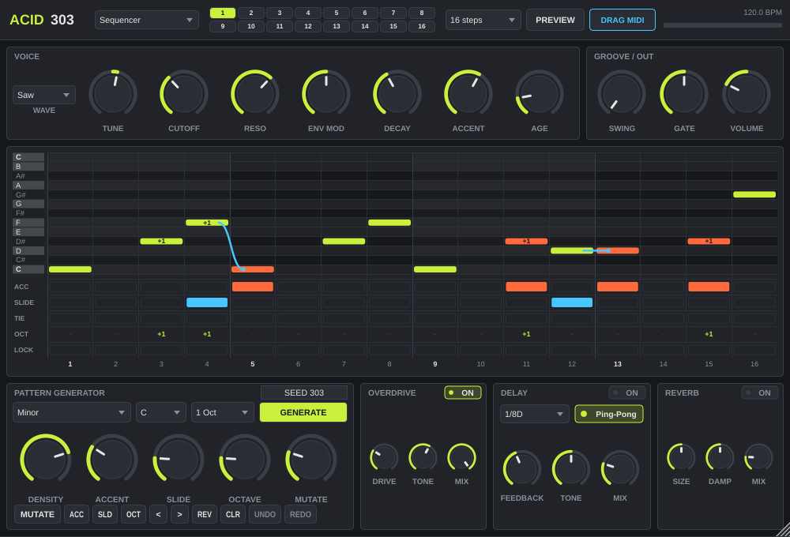

# Acid303

A 303-style acid bassline instrument (VST3 / AU) built for writing and generating
acid lines quickly in Ableton Live: a compact step piano roll with accents and
glides, a seeded pseudo-random pattern generator, a vintage-modelled mono voice and
a built-in overdrive → delay → reverb chain.



> Acid303 is an independent project and is not affiliated with Roland Corporation.

## Features

- **Vintage voice**: band-limited saw / square (with the 303's sagging, rounded square),
  zero-delay-feedback diode-style ladder filter with bass-thinning resonance, filter
  envelope (MEG), accent sweep circuit (consecutive accents get brighter), and
  constant-time slide. Runs 2× oversampled. "Age" adds analogue pitch drift.
- **Step piano roll**: 1–32 steps, one octave of notes per step plus octave (-1..+2),
  accent, slide, tie and lock lanes. Glides are drawn between notes. Click to set or clear,
  drag to paint, right-click to rest.
- **Pattern generator**: scale and root aware (minor, phrygian, dorian, harmonic minor,
  minor pentatonic, blues, major, chromatic). Density, accent, slide and octave-jump
  probabilities. Motif-based (call and response) so results sound like basslines rather
  than noise. Also: **Mutate**, re-roll only accents/slides/octaves, shift, reverse,
  per-step locks, undo/redo. Every result has a **seed** you can type back in.
- **16 pattern slots** saved with your Live set (shift-click a slot to copy into it).
- **Host sync**: follows Live's tempo and transport sample-accurately, with swing and gate.
  **Preview** runs the pattern on an internal clock while Live is stopped.
- **Play modes**: *Sequencer*, *Seq + Transpose* (incoming MIDI keys transpose the pattern,
  C3 = no transpose), and *MIDI* (play the voice from clips: overlapping notes slide,
  velocity ≥ 100 = accent).
- **Drag MIDI**: drag the current pattern straight into a Live clip slot.
- **FX**: asymmetric overdrive with tone, tempo-synced delay (1/32 … 1/2, dotted/triplet,
  ping-pong, damping), reverb. All parameters are automatable.

## Worlds

Acid303 has three **worlds**, picked with the **World** selector in the top bar (or any of
the MIDI methods below). Classic is the instrument as designed; the other two nudge it in a
direction — subtle changes meant to suggest new ideas, not effects presets.

| | Classic | Space | Underground |
|---|---|---|---|
| Scales | the original eight | Lydian, Whole Tone, Dorian | Harmonic Minor, Phrygian Dominant, Diminished (half-whole) |
| Generator | as before | sparser, fewer accents, longer slides and ties, phrase left open on the last step | a tense note (leading tone or ♭2) slides into the root on beats 1 and 3 |
| Voice | as before | slides 1.5× longer, softer accents, slow filter drift | sine sub one octave down, tighter decay, harder accent |
| Character knob | **Age**: pitch drift | **Drift**: pitch + filter wander | **Sub**: sub level |

**Your pattern is kept.** Switching worlds retunes what plays: notes outside the new scale
move to the nearest scale note, locked steps never move, and switching back to Classic
restores every original note (the pattern you wrote is stored untouched). Each world
remembers the scale you last chose in it.

**Switching from MIDI** (on by default; turn off with the *World MIDI* parameter):

- **Automation / MIDI Map**: the *World* parameter, like any other.
- **CC 102**: 0–42 Classic, 43–85 Space, 86–127 Underground.
- **Program change**: 1, 2, 3 in Live's clip *Pgm* chooser (MIDI programs 0, 1, 2).
- **Keyswitch notes**: C-2, C#-2, D-2 in Live (MIDI notes 0, 1, 2). They never play or
  transpose, so they work in every play mode.

While the transport runs, a change lands on the **next bar** by default (*World Switch* in
the Groove panel: Immediate / Next Beat / Next Bar), sample-accurately.

## Installing a build

Download the zip for your platform from the GitHub Actions artifacts or Releases page.

- **macOS**: copy `Acid303.vst3` to `~/Library/Audio/Plug-Ins/VST3/` and/or `Acid303.component`
  to `~/Library/Audio/Plug-Ins/Components/`. The builds are ad-hoc signed (not notarised),
  so clear the quarantine flag first:
  `xattr -dr com.apple.quarantine ~/Library/Audio/Plug-Ins/VST3/Acid303.vst3`
- **Windows**: copy `Acid303.vst3` to `C:\Program Files\Common Files\VST3\`.

In Live: rescan plugins, drop **Acid303** on a MIDI track and press play.

## Building from source

Requirements: CMake ≥ 3.22, a C++20 compiler (Xcode 14+, Visual Studio 2022, GCC 11+ / Clang 14+).
JUCE and Catch2 are fetched automatically (pinned versions).

```bash
cmake -B build -DCMAKE_BUILD_TYPE=Release
cmake --build build --config Release --parallel
ctest --test-dir build -C Release --output-on-failure
```

Plugins end up in `build/Acid303_artefacts/Release/{VST3,AU,Standalone}`.
On macOS add `-DCMAKE_OSX_ARCHITECTURES="arm64;x86_64"` for a universal binary.
On Linux install JUCE's dependencies first (see `.github/workflows/build.yml`).

Options: `-DACID_BUILD_PLUGIN=OFF` builds only the headless engine, tests and tools,
which is handy for fast DSP iteration.

### Offline render tool

`acid_render` renders a pattern through the full engine to a WAV file, with no DAW needed
(add `--world 1` or `--world 2` for Space or Underground):

```bash
./build/acid_render_artefacts/Release/acid_render out.wav --seed 99 --bars 8 --reso 0.9 --envmod 0.8 --delay
```

## Project layout

```
Source/
  core/    Engine, parameter spec, LiveState       ─┐
  dsp/     oscillator, ladder, envelopes, voice, FX  ├─ acid_core: no GUI dependency
  seq/     pattern, sequencer, generator, controller ─┘
  plugin/  AudioProcessor / Editor (thin adapters)
  ui/      the bundled JUCE interface (replaceable)
Tests/     Catch2 unit tests (DSP, timing, generator, state, engine)
tools/     acid_render
```

See [docs/ARCHITECTURE.md](docs/ARCHITECTURE.md) for how the engine and UI are separated
and how to build a new front end.

## License

AGPL-3.0-or-later (see [LICENSE](LICENSE)), as required by JUCE 8's open-source
license. If you want to distribute closed-source builds you need a commercial JUCE license.
